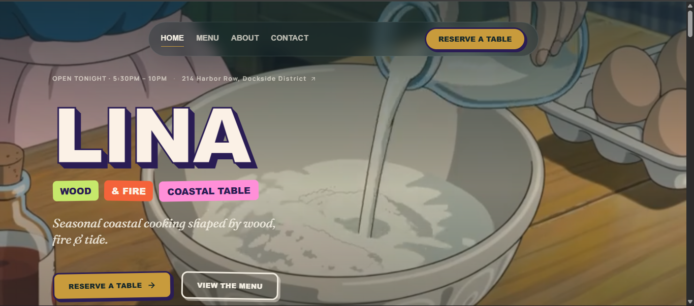
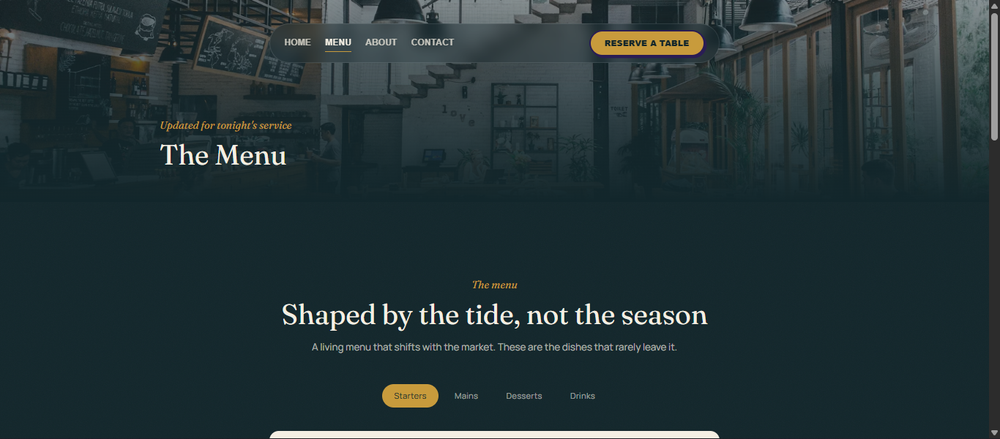
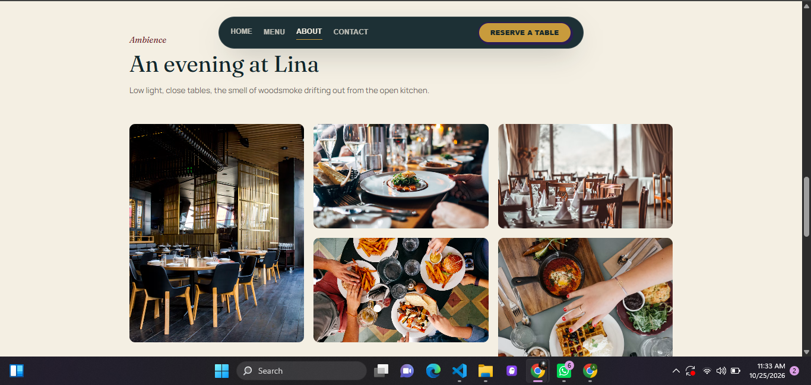
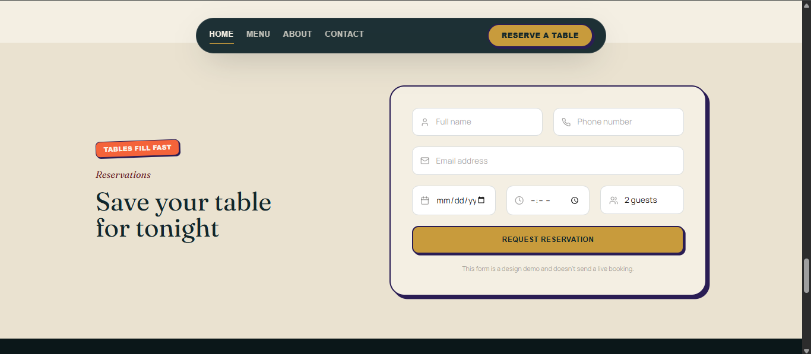
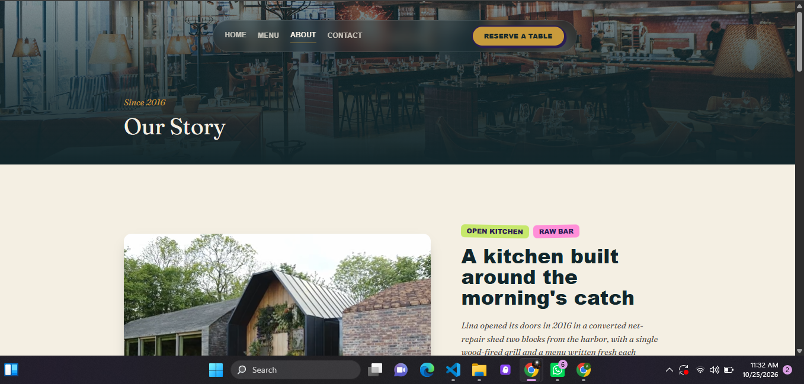
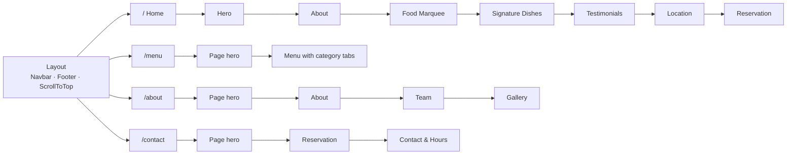

<div align="center">

# 🌊 Lina — Coastal Table & Wood Fire

### A cinematic, video-first restaurant website that makes you hungry before you reach the menu.


**[🚀 Live Demo](https://lina-restaurant-website.vercel.app/)** · **[🎬 Demo Video](https://drive.google.com/file/d/1sSLiLmK7GrsRa7uOwR-b9bmjHKRs0uZY/view?usp=sharing)** · **[📂 Source Code](https://github.com/alinairshad/lina-restaurant-website)**

</div>

---

## 📖 Table of Contents

- [The Idea](#-the-idea)
- [Highlights](#-highlights)
- [Screenshots](#-screenshots)
- [Pages & Sections](#-pages--sections)
- [Design System](#-design-system)
- [Tech Stack](#-tech-stack)
- [Architecture](#-architecture)
- [Getting Started](#-getting-started)
- [Rebrand It in Minutes](#-rebrand-it-in-minutes)
- [Accessibility & Performance](#-accessibility--performance)
- [Roadmap](#-roadmap)
- [Team](#-team)

---

## 💡 The Idea

Most restaurant websites are a PDF menu, a blurry photo and a phone number. But people choose where to eat with their eyes first, and a restaurant's website is often the very first table a guest sits at.

**Lina** is a concept restaurant brand (coastal Mediterranean cooking, wood-fired, in the Dockside District) built to show what a restaurant website can be when it is designed like a brand experience instead of a brochure:

- **Moving food, not static stock photos.** Full-bleed video in the hero, the kitchen story, the signature dishes and the guest reviews.
- **A personality you remember.** A playful "sticker" visual language (chunky outlines, hard offset shadows, tilted badges) sitting on top of an elegant serif and parchment palette.
- **A path to a booking in one click.** The "Reserve a table" button is always in reach, in a floating navbar that follows you down the page.

> Lina is a concept brand created for this project. The menu, guest quotes and team names are sample content, kept in separate data files so they are easy to replace.

---

## ✨ Highlights

| | Feature | Details |
|---|---|---|
| 🎥 | **Video-first storytelling** | Autoplaying, muted, looping background videos in the hero, about, signature dishes and testimonials sections, each with a poster image fallback |
| 🧃 | **Sticker-style UI** | Rotated colour badges, thick plum outlines and hard offset shadows that "press in" on hover, used consistently across buttons, badges and cards |
| 🔠 | **Extruded hero wordmark** | The big "LINA" title is built from stacked text-shadows plus a text stroke, with no image asset |
| 🧭 | **Floating glass navbar** | A pill-shaped nav that blurs the page behind it, becomes more opaque on scroll, and collapses into an animated mobile menu |
| 🍽️ | **Interactive menu** | Category tabs (Starters, Mains, Desserts, Drinks) filter 18 dishes with animated layout transitions, dotted price leaders and "Signature" tags |
| 💬 | **Auto-rotating testimonials** | A review carousel with star ratings and prev/next controls, over an ambient video background |
| 📅 | **Reservation form** | Name, email, phone, date, time and party size with native validation, focus-reactive fields and an animated confirmation state |
| 🕒 | **Hours & directions** | Opening hours table, a hand-drawn SVG map sketch and a one-click Google Maps link |
| 🍋 | **Playful footer** | Letters and hand-built SVG food icons (burger, croissant, pizza, tomato, lemon and more) drop into a pile when the footer scrolls into view |
| ♿ | **Motion-aware** | Hero and About videos swap to still images for visitors who prefer reduced motion |
| 🧱 | **Content-driven** | Menu, testimonials and gallery live in plain JS data files, so changing content never means touching components |

---

## 🖼 Screenshots

Add your screenshots to docs/screenshots/ and uncomment the table below.
Tip: a short GIF of the hero + scroll + footer animation...


| Home / Hero | Menu |
|---|---|
| Home / Hero | Menu |
|---|---|
|  |  |

| Signature Dishes | Reservation |
|---|---|
|  |  |

| About |
|---|
|  |
---

## 🗺 Pages & Sections

The site is a React Router app with four routes, each assembled from reusable section components.



| Route | What visitors see |
|---|---|
| `/` **Home** | Video hero with address and hours, kitchen story, scrolling highlights ticker, three signature dish video cards, guest testimonials, location and hours, quick reservation |
| `/menu` **Menu** | Full menu in four categories with live filtering and animated transitions |
| `/about` **About** | The restaurant's story ("Since 2016"), team cards and an ambience photo gallery |
| `/contact` **Contact** | Full reservation form plus contact details, opening hours and directions |

Several sections take a prop to adapt to where they appear. For example, `<Reservation compact />` is a short version on the home page and the full version on `/contact`. This keeps the code DRY and the pages consistent.

---

## 🎨 Design System

### Palette

| Token | Hex | Used for |
|---|---|---|
| `ink` | `#12262B` | Deep teal-black, dark sections and navbar |
| `parchment` | `#F4EFE3` | Warm page background |
| `gold` | `#C89B3C` | Primary buttons, accents, focus ring |
| `wine` | `#6B1E23` | Tags and links |
| `char` | `#211E1B` | Body text |
| Sticker accents | `#C6E86B` · `#F4633A` · `#FF8FD8` | Lime, coral and pink badges |
| Sticker outline | `#2A1D54` | Borders and hard shadows |

### Typography

- **Fraunces**: elegant variable serif for headings and prices
- **Manrope**: clean, readable body text
- **Baloo 2**: rounded display face for sticker badges, buttons and the hero wordmark

### Signature UI pattern

Every button, badge and card shares the same "sticker" DNA: a 3px plum border, a hard offset shadow, and a small translate on hover that makes it feel physically pressed. A custom Tailwind theme (`tailwind.config.js`) defines the colours, fonts, shadows, easing curve and a subtle SVG film-grain texture used on dark sections.

---

## 🛠 Tech Stack

| Layer | Technology |
|---|---|
| UI library | React 18 |
| Build tool | Vite 5 |
| Styling | Tailwind CSS 3 with a custom theme, PostCSS and Autoprefixer |
| Animation | Framer Motion 11 (scroll reveals, `AnimatePresence`, layout animations) |
| Routing | React Router 6 |
| Icons | Lucide React plus hand-built SVG food illustrations |
| Media | Self-hosted MP4 video, Unsplash image fallbacks |

---

## 🏗 Architecture

```
lina-restaurant-website/
├── index.html                  # Entry HTML, fonts, meta tags
├── tailwind.config.js          # Design tokens: colours, fonts, shadows, easing
├── vite.config.js
├── public/
│   └── videos/                 # Hero, kitchen, dish and ambience videos
└── src/
    ├── main.jsx                # App entry (BrowserRouter)
    ├── App.jsx                 # Route definitions
    ├── index.css               # Tailwind layers, marquee keyframes, reduced-motion rules
    ├── pages/                  # Home · MenuPage · AboutPage · ContactPage
    ├── components/
    │   ├── layout/             # Layout, Navbar, Footer, FallingElements (food icons)
    │   ├── sections/           # Hero, About, FoodMarquee, SignatureDishes,
    │   │                       # Testimonials, Location, Menu, Gallery,
    │   │                       # Reservation, Contact
    │   └── ui/                 # Button, SectionHeading, RatingStars, Ornament,
    │                           # ShapedVideoCard, ShapeDefs (reusable primitives)
    ├── data/                   # menu.js · testimonials.js · gallery.js
    └── hooks/                  # useActiveSection.js
```

**Design decisions**

- **Pages are thin, sections are reusable.** Pages only compose sections, so layouts can be rearranged without rewriting UI.
- **Content is data.** The menu, testimonials and gallery are plain arrays in `src/data/`, ready to be swapped for a CMS or API later.
- **One source of truth for style.** Colours, fonts, shadows and easing come from the Tailwind theme, not scattered values.
- **Scroll to top on navigation.** A small `ScrollToTop` helper in `Layout` makes route changes feel like real page loads.

---

## 🚀 Getting Started

### Prerequisites

- [Node.js](https://nodejs.org/) 18 or newer
- npm (comes with Node.js)

### Run locally

```bash
# 1. Clone the repository
git clone YOUR_GITHUB_REPO_LINK
cd lina-restaurant-website

# 2. Install dependencies
npm install

# 3. Start the dev server
npm run dev
```

Open the URL Vite prints, usually **http://localhost:5173**.

### Production build

```bash
npm run build      # outputs to /dist
npm run preview    # serves the production build locally
```

### Available scripts

| Command | Description |
|---|---|
| `npm run dev` | Start the Vite dev server with hot reload |
| `npm run build` | Create an optimised production build |
| `npm run preview` | Preview the production build locally |

---

## 🎛 Rebrand It in Minutes

Lina is built so it can be reskinned for another restaurant without a rewrite.

1. **Colours & fonts:** edit the `colors` and `fontFamily` blocks in `tailwind.config.js`, and the Google Fonts `<link>` in `index.html`.
2. **Menu:** edit `src/data/menu.js`. Each item has an `id`, `category`, `name`, `description`, `price` and an optional `tag`.
3. **Testimonials:** edit `src/data/testimonials.js`.
4. **Gallery:** edit `src/data/gallery.js`.
5. **Name, tagline and address:** update `Navbar.jsx`, `Footer.jsx`, `Hero.jsx` and `Location.jsx`.
6. **Videos:** replace the files in `public/videos/` (keep the same filenames, or update the paths in the section components).

---

## ♿ Accessibility & Performance

- **Reduced motion:** the Hero and About sections check `prefers-reduced-motion` and show a still image instead of video. A global CSS rule also shortens animations and transitions for those users.
- **Visible keyboard focus:** a gold `:focus-visible` outline is applied site-wide.
- **Semantic structure:** landmarks (`header`, `main`, `nav`), real buttons and links, labelled controls (for example the mobile menu toggle), and descriptive `alt` text on images.
- **Form usability:** native HTML validation with the right input types (`email`, `tel`, `date`, `time`) so mobile keyboards and pickers adapt automatically.
- **Mobile-first and responsive:** the layout, hero typography and mobile navigation are designed for small screens first.
- **Lazy-loaded images** where appropriate, and `muted playsInline` videos so autoplay works on mobile browsers.

---

## 🔭 Roadmap

The current build is a polished frontend. Here is where it goes next:

- [ ] **Real reservations:** connect the form to a backend or a service (Node/Express, Supabase or Firebase) with email confirmation. The form is currently a front-end demo that simulates the submit.
- [ ] **Live map:** replace the SVG map sketch with an interactive Google Maps or Mapbox embed.
- [ ] **CMS-driven content:** move the menu and testimonials from `src/data/` to a headless CMS so staff can update dishes without a developer.
- [ ] **Online ordering & gift cards.**
- [ ] **Video optimisation:** compress and stream videos at multiple resolutions for faster first load on slow connections.
- [ ] **Multi-language support** (i18n).
- [ ] **Automated tests** for the menu filter and reservation flow.

---

## 👥 Team

Built for **Craftsolve Hackathon 2026**.

| Name | Role |
|---|---|
| Alina Irshad | Design & Development |

---

<div align="center">

**If you enjoyed this project, please give it a ⭐ on GitHub!**

Made with ❤️, React and a lot of imaginary wood-fired flavour.

</div>
